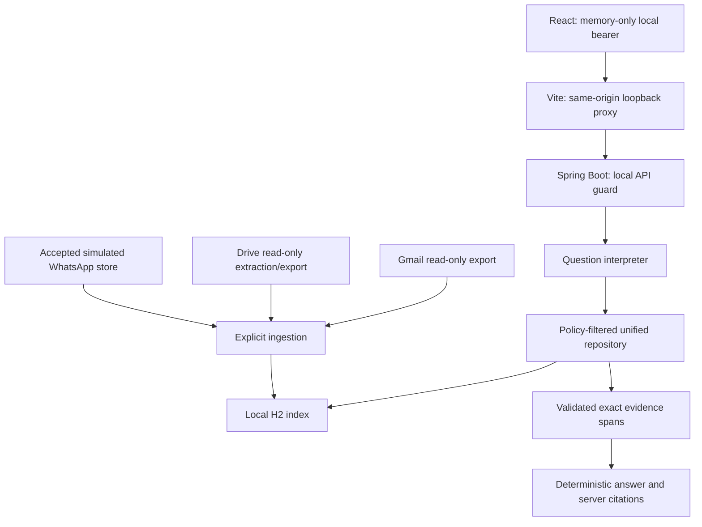

# Architecture

## Implemented application

React/Vite is a separate local frontend. Spring Boot exposes loopback APIs protected by a local bearer token, except health and exact state-validated OAuth callback GET routes. Gmail Desktop OAuth returns to the loopback root (`GET /`); Drive keeps its own exact callback path. The Gmail root route validates the one-time state and PKCE-backed flow before exchanging a code. Other root methods and protected API routes remain bearer-protected. The frontend proxies /api and /health to the backend; permissive backend CORS is not enabled. The callback change is synthetic-tested and has not been verified through live Google consent.

Gmail and Drive have separate least-privilege Desktop OAuth/PKCE grants using an external client JSON. Refresh tokens are encrypted with AES-256-GCM; keys, tokens and actual connector output live outside the repository. The custom WhatsApp-style adapter only accepts synthetic text events and rejects unselected groups before content validation/analysis/persistence.

Milestone 2 extends the validated live query plan with exactly “Show my Gmail emails from yesterday,” “Show my Gmail emails from today,” and “Show my latest 10 Gmail emails.” Relative days use an injected clock in Asia/Kolkata; date requests use the existing 20-message cap and latest-email requests set Gmail `maxResults=10`. Both retain one-page partial-result disclosure without fetching a continuation page. The dashboard requires a fresh affirmative confirmation before each live Ask, sends no request on cancellation, blocks duplicate pending submissions, stores no consent, and does not authorize sync. Local-only Ask, transient Gmail retrieval, deterministic citations, existing REST/response limits, no-retry behavior, sync and export remain unchanged. Answers are exact evidence excerpts, not generated summaries. Development and independent Personal Testing synthetic/full-suite verification passed. A user-reported live yesterday question returned nine messages and nine citations; this is limited live evidence, not an independent test. Today/latest-10, multi-page warning and provider-failure behavior remain synthetic-only, so M2 remains PARTIAL.

## Packages and boundaries

| Layer | Responsibility |
| --- | --- |
| controller | OAuth callbacks, exports, ingestion, search, Q&A and health endpoints |
| service | OAuth/token handling, analysis/classification/extraction, export mapping and ingestion |
| service/qa | Small question grammar, bounded retrieval, deterministic evidence selection, citation assembly |
| connector | Official Google HTTPS reads, quota-aware transport, local H2 repositories |
| model | Shared SourceRecord, source outputs, SearchRecord and QuestionAnswer |
| config | Loopback settings, local bearer/no-store guard, clock and immutable simulated group policy |

No document content can authorize operations, change retrieval filters or execute tools. The deterministic provider can select only already retrieved spans; the server validates hashes/source versions and assembles references. There is no registered external AI provider. A future provider interface exists, but external modes fail closed.

## Shared source and search records

SourceRecord preserves document_id, tenant_id, connector_account_id, source_type, external_id, parent_external_id, title, content_text, mime_type, content_hash, source_version, provider creation/update times, occurred_at, ingestion/sync times, deleted_at and provider metadata. Unknown times/owners remain null.

Source types are GMAIL, DRIVE and WHATSAPP. IDs are scoped to tenant/account/type/provider ID; WhatsApp also includes group identity to match accepted-message storage. Same content in different accounts is not deduplicated across accounts. Metadata keeps available Gmail sender/labels/attachment analysis, Drive extraction/category information and simulated group/sender references.

SearchRecord wraps the shared source with data_mode, classification, available participant, source-specific analysis and a normalized document/version/type/locator citation. Drive owners are absent unless supplied by metadata. WhatsApp classification is explicitly unclassified.

Q&A citations add server labels, original source IDs, accounts, document/version/locator and exact content spans. Offsets are zero-based Java UTF-16 units, end exclusive; no chunk/vector table is implemented. Excerpts attribute what a record says, not independent truth.

## Persistence and retrieval

The unified H2 repository uses transactional idempotent upserts. Identical evidence is unchanged; substantive updates replace the same identity; tombstones remove rows. During each explicit Personal repository upsert transaction, at most 100 expired Personal LIVE Gmail rows for the configured tenant and approved account are physically removed from the live table and receive hashed-identity tombstones in the same transaction. Export ingestion and sync batches use this transaction path; there is no scheduler or provider request for purge. Tombstones remain durable without expiry while stale exports remain replayable. Missing records in a limited export do not imply deletion. Older snapshots are not rejected automatically, and first-seen history is not reconstructed. SQL row removal does not erase old backups or guarantee forensic media erasure; backup cleanup and restore validation remain separate P7 work.

WhatsApp ingestion reads the authoritative accepted store, never an uploaded JSON snapshot. SQL applies current configured tenant, simulated account and selected_groups before decoding search JSON. Revoked groups are immediately hidden from retrieval and pruned on refresh; historical accepted-message storage retains its existing retention behavior.

Search supports literal keyword, source, classification, account, participant, parent/group, mode, time and bounded paging. Q&A derives simple English source/category/ISO-date constraints, searches at most 100 rows per source/topic and returns at most eight exact excerpts. Unsupported or missing evidence abstains. See [storage contract](docs/UNIFIED_STORAGE.md) and [Q&A contract](docs/QUESTION_ANSWERING.md).

## Public demo and private runtime

Public fixtures generate 7 synthetic Gmail, 2 synthetic Drive and 6 simulated WhatsApp records, including the fabricated USD 1200 invoice. They require no Google access. Real OAuth, reads and outputs are separate, external and optional. Live verification reports only aggregate evidence; no private record is published or supplied to external AI.

The documented helpers are Windows/PowerShell conveniences. Put runtime and client files outside every checkout, retain encryption keys across restarts and review custom locations. The backend is loopback/single-user practice software, not production multi-user authorization.

## Future design, not implemented

MySQL migrations, user/tenant membership ACLs, automatic provider permission refresh/deletion, durable sync jobs/cursors, monotonic versions, OCR, semantic/vector/chunk retrieval, a real AI provider, live Meta webhook signatures/accounts, frontend ingestion management and deployment remain future work. Earlier sprint design notes may describe these intentions; they are not working features.

The confirmed eight-hour plan and history remain in PROJECT_TRACKER.md. Executed checks and limits are in TEST_RESULTS.md; synthetic tests do not prove live format/full-inventory coverage.

## Optional Personal profile on `feature/personal-connectors`

`GOOGLE_ACCESS_MODE` defaults to `SANDBOX`; `PERSONAL` requires separate enablement and explicit approval plus the exact personal Gmail identity. Gmail uses `gmail.readonly`. Personal Drive is a separate opt-in (`PERSONAL_DRIVE_ENABLED=false` by default); its account/root identity and isolated token/export paths are required only when enabled, and all Drive access routes and ingestion fail closed otherwise. When enabled it uses `drive.readonly`. Explicit fresh Personal initialization creates a new external runtime, generated local API/encryption keys, a unique `personal-*` tenant and an empty unified H2 schema; the schema helper runs offline only in the initialization branch and refuses existing database/token artifacts. It imports no historical Gmail rows and performs no OAuth/provider operation. Normal startup validates the existing runtime, Gmail token/export, any enabled Drive paths, H2 store, encryption/API keys and tenant before connector endpoints are available. The launcher checks private paths against every registered Git worktree. Personal mode accepts only LIVE records for the configured account/root, rejects synthetic connector snapshots and WhatsApp ingestion, and filters unified retrieval to LIVE records. It uses a distinct external H2 database, so challenge fixtures do not share a personal index.

The Personal product goal is direct, explicitly authorized Gmail use with verifiable citations and transient results. Personal mode no longer exports Gmail snapshots, ingests snapshots, synchronizes Gmail into H2, searches indexed Gmail rows, or answers from locally indexed Gmail. The backend rejects those routes before provider, file or repository work. Earlier snapshots and indexed rows are not deleted or migrated by this gate and may remain until a separately approved lifecycle operation. Explicit live Gmail Ask, protected Live Gmail Search and the separately approved Full Email Viewer continue to retrieve bounded data transiently. The live Ask and Search paths verify the configured account and use their existing approval, deadline, request-size, result-count, citation and no-retry controls. Their responses are not written to H2, checkpoints, tombstones or exports. The direct typed search remains bounded to 20 messages in one page, with partial-coverage disclosure and no direct retries; its existing Gmail REST/request/response budgets are unchanged. Challenge/SANDBOX retains its existing export, ingestion, sync and local-index Q&A behavior. This gate does not delete existing Personal data or resolve P7 export/log retention, OAuth revocation, backup cleanup or recovery requirements. Historical live observations remain recorded as such; they do not authorize future operations or imply complete mailbox coverage. No AI service or AI-generated summary is introduced.

### Live Gmail Search backend — bounded synthetic implementation

The protected `POST /api/gmail/search/approval` and `POST /api/gmail/search` routes provide typed, transient search results for the existing Full Email Viewer. The approval stores one validated plan for 60 seconds, bound to the authenticated principal, browser-session UUID, Personal tenant and configured Gmail account. The search consumes that capability once before OAuth/Gmail access. Both routes enforce same-origin and local bearer checks; the global guard sets `Cache-Control: no-store`. Result selection handles remain server-side and opaque to the browser.

Request bodies are capped at 1 KiB before Jackson parsing. Duplicate keys, malformed JSON, excessive nesting and overlong strings fail with HTTP 400; oversized bodies fail with HTTP 413. The controller starts the approval's five-second budget or search's 180-second monotonic budget before body reading. Body reading, parsing, approval registry coordination, OAuth token locking/refresh, profile and Gmail calls, MIME processing, evidence/result mapping and selection registration run under that operation budget. Search uses the deadline-aware viewer HTTP transport and OAuth lock method; legacy direct Ask/search and synchronization continue to use their existing transport paths. Gmail REST attempts remain capped at 27, one response page and 20 messages, with 2 MiB per response and 10 MiB aggregate; the five text-attachment and 500 MIME-part limits remain. Provider calls do not retry. Gmail profile identity is checked before message retrieval, and continuation metadata yields an explicit partial-coverage response without another page. No result body or selection is persisted or logged.

Approval and search ingress share a separate two-worker, zero-queue executor, independent of the Full Email Viewer executor. This caps executing searches at two; full capacity rejects further work with a content-free HTTP 503, without caller-runs. A timeout returns a fixed content-free response subject to JVM scheduling and HTTP delivery. Cancellation is best-effort; a blocked servlet-body read or other worker may retain one of the two slots until it exits, and overload rejection remains in force while capacity is retained. The budget begins at controller entry after servlet dispatch; connection/header waiting before that point is outside the contract. The cutoff does not guarantee immediate local thread/socket cleanup or termination of remote Google processing. Synthetic tests verify these boundaries; this backend work does not add a frontend search experience or change milestone status.

## Bounded reasoning extension (M3)

The existing Q&A service now delegates three recognized business-question grammars to BoundedReasoningService. It reuses policy-filtered H2 retrieval and the same citation/hash validation, performs decimal aggregation over explicit dated invoice evidence, reads Gmail analysis/reference/thread metadata, and resolves a configured selected Site team group with UTC week bounds. Default-deny sales completeness and group mapping prevent unsupported conclusions. Configuration, supported fact grammar, snapshot limits and synthetic reproduction are documented in docs/BOUNDED_REASONING.md. General keyword behavior remains available; there is no LLM or new database architecture.

## M4 simulated metadata and public artifacts

The accepted-message H2 database now also stores scoped, versioned group metadata in a separate table. Group allowlisting precedes roster validation; metadata updates never rewrite message content/identity. Exports join current supplied metadata and bounded exact-span participant interpretations. Optional selected_groups JSON configuration replaces the env allowlist and fails closed. PublicOutputGenerator is test-classpath-only, uses controlled fixtures and canonical serialization, and produces only the three reviewed provisional public JSON files. Private runtime exports remain external and ignored. See docs/WHATSAPP_SIMULATED.md and docs/PUBLIC_OUTPUTS.md.

## Gmail full-email viewer — backend Phase 1

The protected selected-message detail flow is separate from sync and local indexing. A live Gmail search result can receive an opaque short-lived selection handle bound to the authenticated bearer-token fingerprint, a caller-supplied UUID browser session, tenant and approved Gmail account. A same-origin approval endpoint issues a single-use 60-second token only after the UI's fresh confirmation; the detail endpoint consumes it before network access. Both endpoints require the existing bearer guard, the same session header and an exact configured loopback Origin. The detail gateway verifies the current Gmail profile against the approved account before one `messages.get?format=full` request. The `/view-approval` and `/view` controllers create a monotonic 18-second local operation budget before checking request headers or reading a body. Their JSON bodies are read on the same dedicated bounded viewer executor (two workers, two queued; reject-on-full), with a 1 KiB limit, per-byte deadline checks and an independent response-cutoff timer; no Spring body deserialization occurs before the controller. A slow or incomplete body makes the controller return a fixed timeout response without issuing/consuming approval or starting OAuth/Gmail work. The worker reading a blocking servlet stream may remain occupied until that read returns; it remains within the two-worker cap, queued requests remain within two slots, and further requests are rejected without caller-runs. After bounded body parsing, the same remaining budget covers approval-registry access, viewer-specific OAuth token coordination/refresh, profile verification, full-message retrieval and MIME/body traversal. OAuth viewer lock waits are timed; normal OAuth, direct Gmail Ask and sync transport behavior is unchanged. The two-call Gmail REST budget includes the profile check, with 2 MiB per response, 4 MiB aggregate and no retries, pages, attachment-content requests or sync. Request timeouts and bounded streaming response bodies are applied by the viewer-only HTTP transport. The budget begins after the servlet container has accepted and dispatched the request; it does not bound pre-dispatch header/connection waiting.

At deadline the local backend returns a fixed content-free timeout response, subject to JVM scheduling and HTTP delivery. Cancellation of worker and HTTP exchange is best-effort; any late result is discarded, and admission capacity remains held until the worker exits. The implementation does not promise immediate worker/socket cleanup or immediate termination of Google's remote processing. It checks the shared budget before each provider operation and performs no further provider operation after expiry.

The response is a minimal transient display DTO. Plain text is preserved; HTML is parsed to inert readable text and non-display blocks are stripped. MIME parts, body length, attachment-name count and header lengths are bounded; missing, malformed, oversized or externalized content is marked unavailable/incomplete. Attachment contents are never requested. No detail is written to repositories, exports, checkpoints or tombstones, and the service does not log content. The global local API guard sets `Cache-Control: no-store`. Phase 1 is synthetic-tested backend infrastructure; Phase 2 adds the React viewer described below. Existing Gmail search, citation, synchronization and local-only behavior remain unchanged.

## Gmail full-email viewer — React Phase 2

The React client creates a cryptographically random UUID for its in-memory browser session and sends it with the authenticated live Ask and message-view POSTs. A “View full email” action appears only on live direct-Gmail evidence carrying a valid opaque selection handle. A fresh per-message browser confirmation precedes the approval call; cancellation sends neither viewer request. On confirmation the client calls `/view-approval` and then `/view` exactly once each, with the same bearer and session scope, and never retries automatically. The UI describes this as one additional user-approved detail operation; the backend performs two Gmail REST calls (approved-profile verification plus the selected full-message read).

The viewer renders only the DTO's plain text with ordinary React text nodes, displays available headers/date in Asia/Kolkata and attachment names only, and flags incomplete or truncated details. It never injects HTML, loads remote resources, requests attachment data, or places message details in persistent browser storage. The transient detail state is cleared on close, new Ask/search, disconnect, or authentication failure; the local API client uses `cache: no-store` and omits credentials. Citation cards show the evidence reference, source, subject and excerpt while omitting internal identifiers from ordinary presentation. Phase 2 has synthetic component-test and production-build evidence only; no live browser viewer or provider read has been performed.
