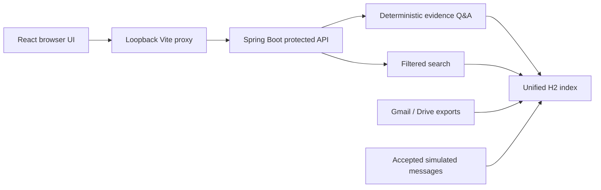

# E9Rental Connector Practice

A local portfolio project that brings rental-business evidence from email, documents and simulated chat into one searchable workspace. Ask a question, inspect the original excerpt and follow its source reference.

## Personal Connector product vision

The primary Personal Connector goal is: **A user securely connects their Gmail account, asks a question in natural language, and the application finds relevant authorized Gmail messages and produces an accurate answer supported by source citations.**

The Personal target workflow is to connect Gmail with read-only Google OAuth, request an explicitly approved live search or question, and show bounded transient results with citations to supporting messages. Personal Gmail export, snapshot ingestion, history sync, indexed Gmail search and local-index Gmail Ask are gated off. Previously created Personal snapshots or H2 rows are not deleted by this gate and may remain until a separately approved data-lifecycle action. Challenge/SANDBOX behavior remains separate. This is the product direction, not a claim that every step works today. See [PROJECT_ROADMAP.md](PROJECT_ROADMAP.md).

Built as an independent, Codex-assisted practice project using a hackathon problem statement. It is a working local demonstration, not an official E9Rental product or a production deployment.

## What works

| Area | Implemented behavior |
| --- | --- |
| Gmail | Official read-only API, Desktop OAuth/PKCE, message/thread retrieval, attachment metadata, classification and unanswered-email heuristics |
| Google Drive | Separate read-only OAuth grant; file listing and bounded extraction for Docs, Sheets, PDF, DOCX, XLSX/XLS; five-category classification |
| WhatsApp-style events | **Simulated only.** Synthetic text events, selected-group filtering, durable acceptance, deduplication, versioned group/roster metadata and evidence-linked interpretations; no Meta account/API |
| Unified index | Local H2 storage, idempotent ingestion, source metadata/citations and protected keyword/filter search |
| Questions and answers | **Deterministic, not LLM-powered.** Exact citations plus bounded sales-month/pending-mail/Site-team reasoning, or explicit insufficient evidence |
| React workspace | Responsive source dashboard, memory-only local token connection, Q&A/citations, search and safe error/loading states |

**The default interactive demo is entirely synthetic:** 7 Gmail records, 2 Drive records and 6 simulated WhatsApp messages. The USD 1200 invoice is a fabricated test record, not a real customer fact. No Google account or external AI key is needed for the demo.

## Architecture and technologies



Java 21 · Spring Boot 3.5.16 · Maven · React 19.3.1 · Vite 8.3.4 · H2 2.5.252 · PDFBox 3.0.8 · Apache POI 5.5.1 · JUnit/Mockito · Vitest/Testing Library · Playwright.

The Google adapters use HTTPS REST APIs. The runtime carries provider provenance into exports and the unified index: the production Google transport labels successful provider reads `LIVE`, while the injected local fixture transport labels them `SYNTHETIC`; an unknown mode fails before listing or reading records. Tokens/exports/databases stay outside Git. The browser receives only the local API bearer you enter; it never receives Google credentials or refresh tokens. MySQL, embeddings, production multi-user authentication and a real AI provider are future work, not implemented components. See [architecture](ARCHITECTURE.md).

## Requirements

- Windows with Windows PowerShell 5.1 for Personal Gmail startup (PowerShell 7 can also invoke the Personal launchers). Historical SANDBOX helpers have separate instructions.
- Git for Windows, with `git` available in PowerShell. The Personal launcher checks `git worktree list` metadata before using a runtime directory.
- Java 21 and Maven 3.6.3+.
- Node.js 24.15+ in the 24.x line and npm; verified with Node 24.19.0/npm 11.17.0.
- Free loopback ports: **8083 for Personal Gmail backend and 5173 for frontend**. The separate synthetic demo below uses backend port 8081; do not run both frontends on 5173 at once.
- Python 3 for the optional standard-library publication audit.

## Clone the repository

Clone with Git (the Personal launcher needs the clone's Git worktree metadata; a downloaded ZIP is not suitable for Personal startup):

```powershell
git clone https://github.com/atharva099/E9Rental-Personal-Connector.git
cd E9Rental-Personal-Connector
```

For your own Gmail account, follow the [Personal Gmail setup guide](docs/PERSONAL_GMAIL_SETUP.md).

## Start Personal Gmail

**First time:** follow the guide to create your own Google Cloud project and Desktop OAuth client, build with `mvn -B clean verify`, install frontend dependencies with `npm ci`, initialize a new external runtime explicitly, and complete manual Google consent. H2 is embedded; no database server is needed. Each developer uses their own credentials and approved Gmail account.

**Later starts:** reuse that initialized, authorized runtime and the existing JAR. From the repository root, in one PowerShell window:

```powershell
$privateDirectory = Read-Host 'Absolute path to your existing Personal runtime'
$clientFile = Read-Host 'Absolute path to your own Desktop OAuth client JSON'
$env:CHALLENGE_RUNTIME_DIR = Read-Host 'Absolute path reserved for your separate Challenge runtime'
$env:PERSONAL_GMAIL_ACCOUNT = Read-Host 'Your approved Gmail account'
$applicationJar = Join-Path (Get-Location) 'target/connector-practice-0.0.1-SNAPSHOT.jar'
.\scripts\Start-PersonalDemo.ps1 -PrivateDirectory $privateDirectory -ClientFile $clientFile -ApplicationJar $applicationJar -ApprovePersonalGoogleAccess
```

The launcher verifies the existing runtime, starts the backend on **127.0.0.1:8083**, then starts the frontend on **127.0.0.1:5173** with the matching proxy. It does not build, install dependencies, initialize data or start OAuth consent. Enter the existing runtime's local API token manually in the dashboard. When operations are idle, press **Q** (or Ctrl+C) in the launcher window to stop; cleanup forcibly terminates only launcher-owned process trees. OAuth consent remains manual if reauthorization is needed. Personal Gmail V1 is read-only and bounded; Drive, WhatsApp, export, sync and persistent indexing are unavailable in this Personal workflow.

Commands below start from the cloned repository root. Keep the runtime directory outside every checkout. The local scripts support -PrivateDirectory; the example uses Windows LocalAppData rather than requiring the original developer's D: drive.

## Run the synthetic demo

Terminal 1, repository root:

```powershell
mvn -B clean verify
$demoRuntime = Join-Path $env:LOCALAPPDATA 'E9RentalConnectorPractice/demo'
./scripts/Start-UnifiedSynthetic.ps1 -PrivateDirectory $demoRuntime
```

Leave it running. In Terminal 2, at the same repository root:

```powershell
$demoRuntime = Join-Path $env:LOCALAPPDATA 'E9RentalConnectorPractice/demo'
./scripts/Verify-UnifiedSynthetic.ps1 -PrivateDirectory $demoRuntime
Set-Location frontend
npm ci
$env:BACKEND_ORIGIN = 'http://127.0.0.1:8081'
npm run dev
```

1. Open **http://127.0.0.1:5173**.
2. Open the runtime's **local-api-token.key** in a local editor. Paste its value into **Local access token**, then Connect. Do not paste it in chat, source files or frontend environment variables.
3. Ask **What is the rental invoice amount in Gmail?** The synthetic answer cites message demo-invoice-1200.
4. Try **Show quotation records across Gmail and Drive**, or **What commitments were made in WhatsApp?**
5. Search by keyword, source, category or data mode. A question such as **Who is the CEO of Neptune?** correctly returns insufficient evidence.

The population helper replays synthetic fixtures and checks that exactly 15 records are indexed. Re-running it is idempotent. It makes no Google/Meta requests. Disconnect clears session data; refresh requires token entry again. Stop the servers with Ctrl+C. Stop any packaged JAR before Maven clean on Windows.

### Personal Gmail status

For clone-and-run instructions for your own Personal Gmail account, follow [Personal Gmail setup](docs/PERSONAL_GMAIL_SETUP.md). Personal Gmail is read-only and bounded; it does not export or persistently index personal messages.

Earlier Personal Testing verified a limited five-message LIVE snapshot, indexed search/Q&A, bounded direct Gmail questions, a user-triggered sync, and the Full Email Viewer. Those observations remain historical evidence; they do not authorize another provider request or establish full-mailbox coverage. The current Personal backend gate disables Gmail export, Gmail snapshot ingestion, Gmail history sync, local-index Gmail search and local-index Gmail Ask. Explicitly approved direct Gmail Ask, Live Gmail Search and the separately approved Full Email Viewer remain transient paths. The gate does not delete previously created export files or H2 records; cleanup, revocation, backup handling and recovery remain separate P7 work, which is still PARTIAL. P9's bounded live-Q&A evidence remains recorded, but its former local-index Gmail fallback is no longer available in Personal. Challenge/SANDBOX paths retain their prior behavior. Personal Drive and Personal WhatsApp ingestion remain disabled. Personal use is separate from the synthetic default demo.

Gmail AI Assistant Milestone 1 is under Development in the Personal worktree: it adds a strict opt-in query form, “Find Gmail emails from <exact-address> about <one-to-three-keywords> between <start-date> and <inclusive-end-date>.” Dates use Asia/Kolkata; regular mail includes Inbox, Sent and archived messages while excluding Spam and Trash. The direct path is bounded to 20 messages, one page, five text attachments, 500 MIME parts, 27 Gmail REST attempts, a 180-second deadline, 2 MiB per response and 10 MiB aggregate response bodies; it does not retry Gmail operations. Additional results are disclosed as partial. Gmail REST attempts and OAuth refreshes are reported separately. Results remain transient and use deterministic citations; there is no external AI provider. Synthetic Development and independent Personal Testing verification passed. User-reported live smoke evidence: the initial interval returned zero matches; a corrected interval returned one existing message with three Gmail REST requests, zero OAuth refresh requests, one supporting citation, and a deterministic excerpt. This single bounded result demonstrates direct retrieval without historical import; the 20-message cap, partial-coverage behavior, and failure safeguards remain synthetically verified rather than comprehensively live-tested. The corrected-date follow-up exceeded the initial one-request approval and is recorded as an authorization-process deviation. The milestone remains PARTIAL; no broader natural-language support, complete mailbox coverage, or generated summary is claimed.

Gmail AI Assistant Milestone 2 remains PARTIAL. It supports exact live-question forms for Gmail emails from today or yesterday and the latest 10 Gmail emails. Relative days use Asia/Kolkata boundaries; date requests are bounded to 20 results and latest-email requests to 10, with one-page partial-coverage disclosure. Topic/date questions return deterministic cited excerpts; the latest-10 intent returns transient structured rows with sender, subject, received time, a short text-only preview and the existing opaque Full Email Viewer handle. The list is bounded and never represents complete mailbox coverage. Each live Ask requires fresh confirmation; cancellation sends no request, duplicate submissions are blocked while pending, and consent is not stored. Previously indexed local Gmail Ask remains in Challenge/SANDBOX; Personal local-index Gmail Ask is rejected. These responses do not generate AI summaries. Synthetic implementation and regression verification are recorded in TEST_RESULTS.md. The user reports one Step 20H latest-10 Ask: the UI showed 10 retrieved messages, 12 Gmail API requests and one OAuth refresh, structured cards and partial-coverage warnings. Screenshots showed the first three cards only; no Viewer action was performed. The screenshots do not independently verify backend logs or persistence, all ten cards were not visually inspected, and the result is not complete mailbox coverage. The earlier user-reported yesterday query remains separate historical evidence. Today, failure/timeout handling and exhaustive coverage remain unverified live; M2 remains PARTIAL.

The Personal frontend also provides a separate **Search Gmail** screen for the protected typed sender/keyword/date search API. Each search requires a fresh confirmation before the frontend requests a short-lived approval and submits the search; cancellation sends neither request. Results are bounded to one page of at most 20 messages, stay in tab memory, and disclose partial coverage. Eligible rows use the existing separately confirmed Full Email Viewer. This screen has synthetic UI verification only; no live search was performed for this feature. The backend persistence gate does not change these direct, transient operations.

## Optional Google connector setup

Challenge-profile live Google access is separate from the synthetic demo. It fails closed unless an explicitly approved dedicated synthetic/sandbox account and direct-child Drive folder are configured. Never reuse personal accounts for Challenge verification. See [sandbox boundary configuration](docs/GOOGLE_SANDBOX_BOUNDARIES.md). That Challenge sandbox is not configured. The separate Personal profile supports bounded, transient live Gmail operations described in [Personal Gmail setup](docs/PERSONAL_GMAIL_SETUP.md); it does not change Challenge restrictions. Historical Personal snapshots are not part of the current Personal workflow.

- [Personal Gmail setup](docs/PERSONAL_GMAIL_SETUP.md): create and use your own Google Cloud project and Desktop OAuth client for bounded, live, read-only Gmail operations.
- [Challenge/SANDBOX Gmail setup](docs/GMAIL_SETUP.md): legacy synthetic/sandbox export workflow only; do not use it to connect Personal Gmail.
- [Challenge/SANDBOX Drive setup](docs/DRIVE_SETUP.md): enable Drive API, reuse the external Desktop client and authorize only drive.readonly. Gmail and Drive grants have separate encrypted token files.
- The `Start-Local.ps1`, `Authorize-Gmail.ps1`, and Gmail export commands in the SANDBOX guide are separate from Personal mode. Do not use those snapshot/export steps for Personal Gmail.
- For the separately approved Challenge/SANDBOX export workflow only, use bounded verification such as `Export-Gmail.ps1 -MaxThreads 1` or `Export-Drive.ps1 -MaxFiles 2` with the same `-PrivateDirectory`. These export commands are not part of Personal Gmail V1. Never commit private outputs.

The launcher generates a random bearer and AES encryption key with restricted Windows file permissions. Process environment variables configure the backend; **.env files are not automatically loaded**. [.env.example](.env.example) is a placeholder reference, not a credential file.

Historical live checks used limited samples only. Full Gmail/Drive inventories and sustained quota behavior are unverified. No live private records are included in the public demo, fixtures or screenshots.

## Test and build

Repository root:

```powershell
mvn -B clean verify
python scripts/audit-publication.py
```

Frontend folder:

```powershell
npm ci
npm test
npm run build
npx playwright install chromium
```

With synthetic backend populated and frontend running, from frontend/:

```powershell
$env:FRONTEND_SMOKE_TOKEN_FILE = Join-Path $env:LOCALAPPDATA 'E9RentalConnectorPractice/demo/local-api-token.key'
npm run test:browser
```

From the repository root, with the same external runtime:

```powershell
$demoRuntime = Join-Path $env:LOCALAPPDATA 'E9RentalConnectorPractice/demo'
./scripts/Verify-QuestionAnswerSynthetic.ps1 -PrivateDirectory $demoRuntime
./scripts/Verify-Integration.ps1 -PrivateDirectory $demoRuntime
```

[Integration verification](docs/INTEGRATION_TESTING.md) documents restart persistence, the 38 API/security assertions, limited-live checking and production-bundle preview. A browser test without FRONTEND_SMOKE_TOKEN_FILE skips; do not report that as a pass.

The historical integrated-main baseline was 141 backend tests; a later development run passed 208 backend tests with 14 frontend tests. The latest comprehensive P9 verification recorded in [TEST_RESULTS.md](TEST_RESULTS.md) passed **260 backend tests**, **15 frontend tests**, and the production build. A later test-fixture-only commit passed the nine synthetic launcher tests independently in both Personal worktrees; backend/frontend suites and packaging were retained from the preceding application-code verification and were not rerun for that fixture-only commit. The timed local synthetic demo and post-demo checks are also recorded in TEST_RESULTS.md. These are dated results, not tests run by this documentation update. Main has not been merged during this completion run.

## Security and limitations

- Local, single-user bearer access; no production login, per-file Google ACL refresh, deployment TLS or hosting.
- H2 is the implemented database. The planned MySQL migration is not implemented.
- WhatsApp is a custom simulation, not an official live webhook/group integration.
- Q&A uses bounded lexical retrieval and exact excerpts. No LLM, general arithmetic/comparisons or independent fact verification. Three bounded business-question types support explicit invoice totals, pending mail and selected Site-team decisions; see docs/BOUNDED_REASONING.md for required completeness/reference configuration and limits.
- PDF OCR is absent. Positive legacy `.doc` extraction has a synthetic fixture test; supported formats do not have comprehensive live coverage.
- Snapshot refresh/ingestion is explicit. Old snapshots may overwrite newer data; already displayed UI results are not automatically revoked.
- Search shows up to 25 rows. Chromium/emulated-mobile tests are not full browser, device or accessibility certification.
- This is not a hosted public demo; no GitHub push or deployment is performed by these scripts.

See [security and publication review](SECURITY.md), [AI assistance disclosure](AI_USAGE.md) and [project tracker](PROJECT_TRACKER.md). Read AGENTS.md and PROJECT_RULES.md before changing the project.

## Repository guide

- src/main/java/com/e9rental — controllers, services, connectors, models and configuration.
- src/test — automated tests and clearly fabricated fixtures.
- frontend — React UI, API client and browser/component tests.
- scripts — local launch, safe verification and publication-review helpers.
- docs — OAuth guides, JSON schemas, storage/Q&A contracts and test instructions.

All feature branches and both original worktrees are retained. Development follows dependency order and fast-forward integration; main is tested before publication. GitHub repository creation, remote selection and push remain separate authorized actions.

## Generated synthetic challenge outputs

The three reviewed files under outputs/ are reproducible SYNTHETIC/SIMULATED practice artifacts, explicitly marked provisional (official organiser schemas are unavailable). Run ./scripts/Generate-PublicOutputs.ps1, ./scripts/Verify-PublicOutputs.ps1 and ./scripts/Generate-PublicOutputs.ps1 -Check in PowerShell 7. See docs/PUBLIC_OUTPUTS.md for schemas, expected counts, negative validation and the separate packaged metadata/interpretation demo. This does not activate Google or Meta access or replace the original 15-record demo.

See [the seven-minute synthetic demo guide](docs/DEMO_7_MINUTES.md) for a timed walkthrough of the dashboard, connector outputs, three PDF questions, citations, abstention and known limitations. Run it only against the documented external synthetic runtime.
